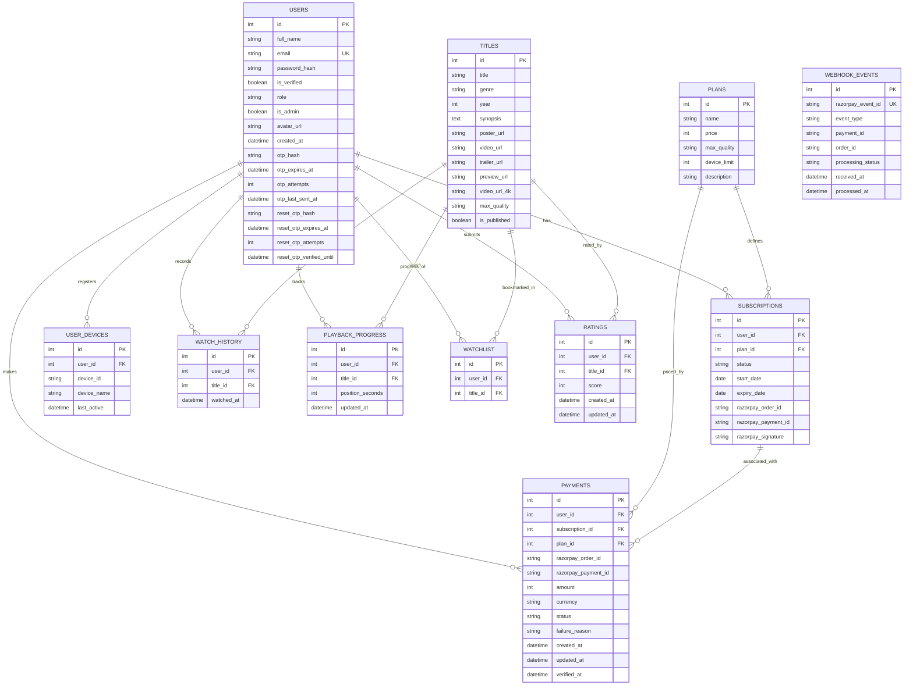

# StreamHub OTT — Database Architecture & Entity Relationship Specification

**Document ID:** PES-UE24CS341A-DB-001  
**Project:** StreamHub – Academic OTT Video Streaming Platform  
**University:** PES University · Department of Computer Science and Engineering  
**Course:** Software Engineering – UE24CS341A  
**Team:** TEAM-04  
**Date:** November 9, 2026  

---

## 1. Overview & Technology Stack

The StreamHub database architecture uses **PostgreSQL** in production and local development, mapped through **SQLAlchemy 2.0 ORM** with asynchronous-capable `Mapped` and `mapped_column` type annotations.

- **DBMS:** PostgreSQL 16+ / SQLite (isolated in-memory test runner)
- **Database Driver:** `psycopg` (binary v3)
- **ORM:** SQLAlchemy 2.0.x
- **Schema Management:** Automated table bootstrap via `app/init_db.py` and programmatic migrations via `migrate_db.py`

---

## 2. Entity-Relationship (ER) Diagram

The following Mermaid diagram visualizes the table schemas, primary keys, foreign keys, and cardinalities:

---

## 3. Table Specifications & Constraints

### 3.1 `users` Table
- Stores viewer accounts, admin role flags, and multi-step OTP authentication states.
- **Constraints:**
  - `email`: `VARCHAR(255) UNIQUE NOT NULL`
  - `password_hash`: Salted bcrypt string
  - `role`: Default `"viewer"`, administrative accounts assigned `"admin"`

### 3.2 `plans` Table
- Authoritative definition of subscription packages and streaming capabilities.
- **Seeded Records:**
  - `Plan ID 1`: Basic — ₹199 / month (19,900 paise), 1080p Full HD, 1 device.
  - `Plan ID 2`: Premium — ₹499 / month (49,900 paise), 4K Ultra HD, 4 devices.

### 3.3 `subscriptions` Table
- Tracks viewer subscription validity.
- **Foreign Keys:**
  - `user_id` -> `users(id)`
  - `plan_id` -> `plans(id)`
- **Lifecycle States:** `pending` -> `active` -> `expired` / `cancelled`.

### 3.4 `payments` Table
- Permanent audit log of every Razorpay transaction attempt.
- **Foreign Keys:** `user_id`, `subscription_id`, `plan_id`.
- **Amount:** Stored in **paise** (`amount = 19900` for ₹199) to prevent floating-point precision loss.
- **PCI-DSS Compliance:** Card numbers, expiry dates, and CVVs are strictly prohibited from this table.

### 3.5 `webhook_events` Table
- Enforces Razorpay webhook idempotency.
- **Constraint:** `razorpay_event_id VARCHAR(100) UNIQUE NOT NULL`.
- Duplicate deliveries of the same event ID are detected and safely skipped without double-charging or extending expiration windows.

### 3.6 `user_devices` Table
- Enforces device concurrency limits based on plan tier (1 device for Basic, 4 for Premium).
- **Index:** `(user_id, device_id)` composite lookup.

### 3.7 `titles` Table
- Primary catalog table for movies and web series.
- **Attributes:** `is_published` boolean flag controls catalog visibility and playback authorization. Separate asset URLs for 1080p, 4K, trailer, and 2-minute preview.

### 3.8 `playback_progress` & `watch_history` Tables
- `playback_progress`: Single row per user and title with `UNIQUE(user_id, title_id)`. Tracks current `position_seconds`.
- `watch_history`: Append-only log of viewing sessions with UTC timestamps (`watched_at`).
