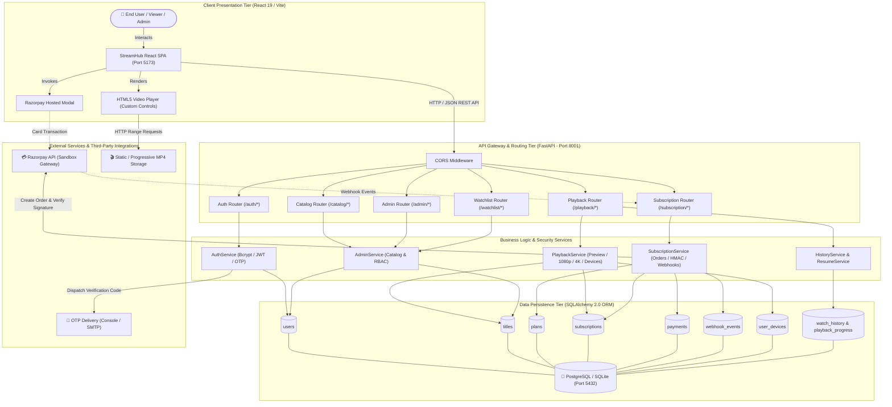
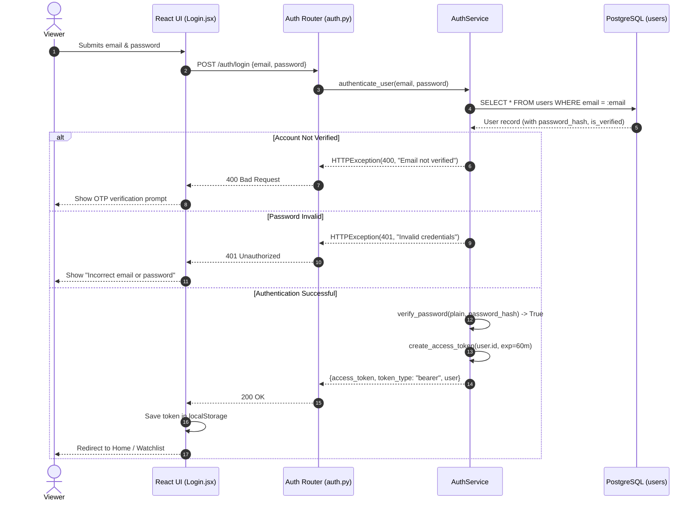
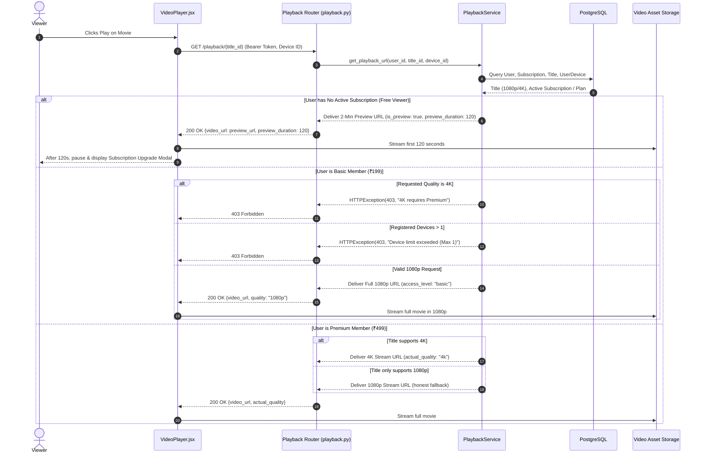
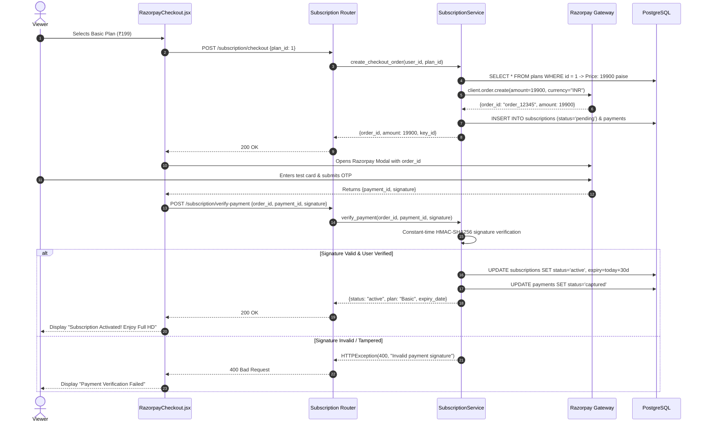
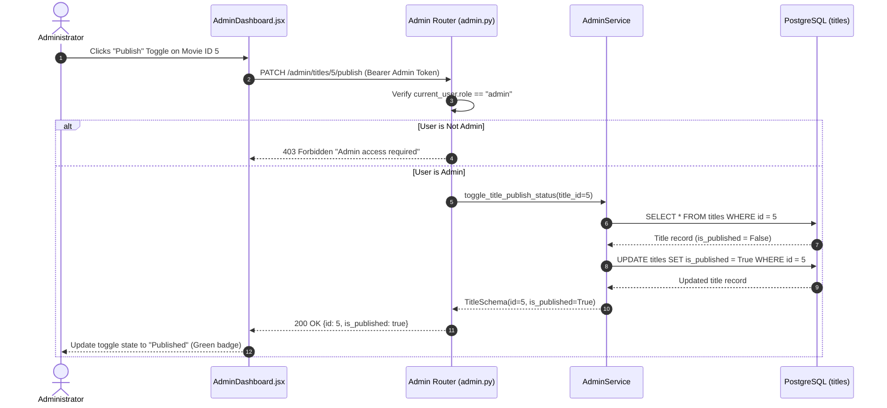

# StreamHub OTT — System Architecture & Request Flows

**Document ID:** PES-UE24CS341A-ARCH-002  
**Project:** StreamHub – Academic OTT Video Streaming Platform  
**University:** PES University · Department of Computer Science and Engineering  
**Course:** Software Engineering – UE24CS341A  
**Team:** TEAM-04  
**Date:** November 9, 2026  

---

## 1. System Architecture Diagram

The following architecture diagram illustrates the end-to-end communication topology of StreamHub, highlighting the separation of concerns across presentation, routing, business logic, persistence, and external integrations:

---

## 2. Detailed End-to-End Request Flows

### 2.1 User Login Request Flow

---

### 2.2 Video Playback Authorization & Quality Delivery Flow

---

### 2.3 Subscription Checkout & Razorpay Activation Flow

---

### 2.4 Admin Publishing a Title Flow

